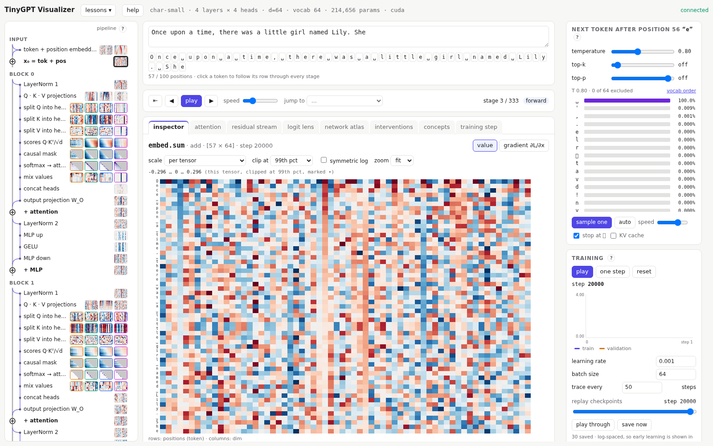
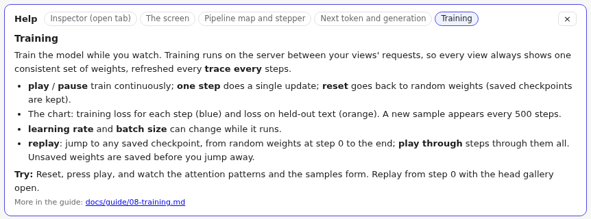

# Getting started

## Install

You need [uv](https://docs.astral.sh/uv/), Node 20 or later, and Chrome or another modern browser. A GPU is optional; the character models train on a laptop CPU.

```sh
uv sync                                   # Python and PyTorch (CUDA wheels on Linux and Windows)
cd ui && npm install && npm run build && cd ..
```

## Choose a model

Models are named by how they read text, then by size:

| Config | Reads | Params | Good for |
| --- | --- | --- | --- |
| `char-tiny` | characters | 32k | the first look: small enough to read every number |
| `char-small` | characters | 215k | **the default**, and most lessons |
| `char-large` | characters | 1.2M | better text; the atlas needs zooming |
| `bpe-small` | BPE tokens (4,096) | 5.8M | the concept explorer: most words are a single token |

Character models see one letter per position, so tokenization needs no explanation and the next-token distribution has only 64 bars. The BPE model reads whole words, which is what you want when you compare how it represents *dog* and *cat*.

## Train it

```sh
uv run python -m core.train --config char-small --steps 20000
```

The first run downloads a slice of [TinyStories](https://arxiv.org/abs/2305.07759), short stories in simple English, and builds the character vocabulary. Training takes about 7 minutes on a GPU and about 30 on a CPU. Every 1,000 steps it prints a sample, and you can watch the text go from noise to *"Once upon a time, there was a girl named…"*.

For the BPE model:

```sh
uv run python -m core.data --bpe          # a larger slice, and a 4,096-token vocabulary
uv run python -m core.train --config bpe-small --steps 20000 --lr 6e-4 --batch-size 128   # ~22 minutes on a GPU
```

Checkpoints are saved under `runs/<config>/` at roughly logarithmic intervals, so that early learning can be [replayed](08-training.md#replaying-training) in detail.

You don't have to train first: with `--train`, the app can train from random weights while you watch. See [Training](08-training.md).

### Or download trained checkpoints

If `runs/<config>/` is empty, the server first downloads that model's checkpoints from Hugging Face ([oshea00/tinygpt-viz](https://huggingface.co/oshea00/tinygpt-viz)), along with the small validation set the neuron examples use. A model that only runs needs nothing else, so a machine without a GPU never downloads or tokenizes TinyStories. The shared checkpoints contain only weights. With `--train`, training continues from them using a fresh optimizer, and the full corpus is built the first time training needs it.

To publish your own runs, log in once with `hf auth login`, then:

```sh
uv run python -m core.hub push --config all     # every profile with checkpoints; --repo <user>/<name> for another repo
```

Set `TINYGPT_HF_REPO` (or pass `--repo` to `core.hub pull`) to download from a repo other than the default.

## Run the app

```sh
uv run python -m core.server --config char-small
```

Then open <http://localhost:8765>. The server loads the latest checkpoint; add `--fresh` to start from random weights. Only one model runs at a time: restart the server with another `--config` to switch.

By default the model only runs: its weights stay as loaded. Add **`--train`** to turn on [training](08-training.md): the training panel, the training step tab and checkpoint replay.

```sh
uv run python -m core.server --config char-small --train
```

## The screen



- **Prompt box** (top middle): every keystroke runs the model again. The chips under it are the positions the model sees, one per token. Click a chip to follow that position through every view.
- **Pipeline map** (left): the network from input to output. See [Pipeline map and stepper](02-pipeline-and-stepper.md).
- **Stepper** (under the prompt): walk the stages one by one.
- **Tabs** (middle): different ways of looking at the same forward pass: the [inspector](03-inspector.md), [attention](04-attention.md), [residual stream and logit lens](05-residual-and-lens.md), the [network atlas](06-atlas.md), [interventions](09-interventions.md), the [concept explorer](10-concepts.md) and, with `--train`, [one training step](08-training.md#one-training-step).
- **Next token** (top right): what the model predicts next, and [generation](07-generation.md).
- **Training** (bottom right, with `--train`): live training and [checkpoint replay](08-training.md).
- **lessons** and **help** (header): [guided lessons](11-lessons.md), and a short explanation of the open tab. The **?** beside the pipeline map, **Next token** and **Training** opens help on that panel; the buttons at the top of the help switch between topics.



### One selection, everywhere

Everything on screen shares one **selection**: a stage, a position, and a dimension or key. Clicking in any view changes it, and every other view follows. Select a token chip and its row is outlined in the inspector, the atlas and the attention matrix. Select a stage in the atlas and the pipeline map scrolls to it. This is how you follow one token through the whole computation.

### Reading the colours

- **Blue, white, red**: signed values: negative, zero, positive. Each heatmap prints its scale above it; by default each tensor gets its own scale.
- **White to purple**: probabilities and attention weights, from 0 up.
- **Grey hatching**: masked cells (a position may not look at later ones), or nothing to show.
- **Outlines** mark the selection; they never change a cell's colour.
