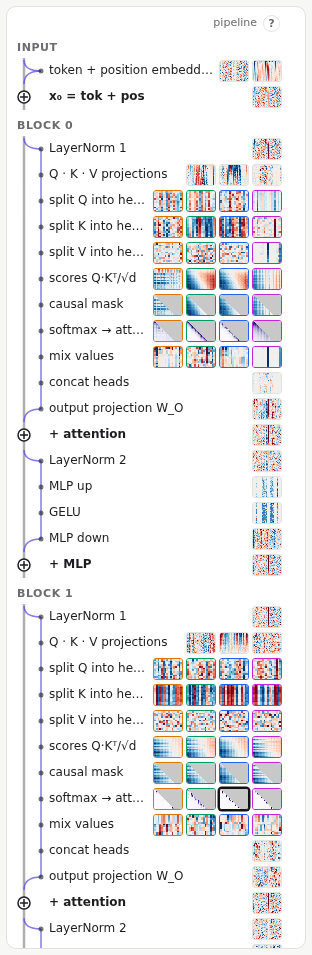

# Pipeline map and stepper

## The pipeline map

The left column is the whole forward pass, top to bottom, one row per stage:

- **The spine** (the vertical line, with ⊕ nodes) is the **residual stream**: the vector each position carries through the network. Embeddings start it, and each block's attention and MLP **add** to it at a ⊕.
- **Branches** (indented) are what each sublayer computes from the stream before adding its result back: layer norm, Q, K and V, the attention heads, the MLP.
- **Thumbnails** show each stage's output for the current prompt. Rows with several thumbnails are per-head stages, one per head, bordered in that head's colour.

Click any thumbnail to select that stage: the inspector shows it, the atlas outlines it, and the stepper jumps to it.

When [interventions](09-interventions.md) are active, stages whose values changed get an orange outline. In [KV cache mode](07-generation.md#kv-cache-mode), rows that came from the cache are greyed in the thumbnails.

## The stepper

The stepper walks the stages in the order they run:

- **◀ / ▶**, or the **←** and **→** keys (also **k** and **j**): previous and next stage.
- **play**: step automatically, at the speed you set.
- **jump to**: the input, any block, the output, or the start of the backward pass.

After the loss, the stepper keeps going backwards up the network: the **backward pass**. Each stage then shows its **gradient**, how much the loss would change if that number changed. The label beside the stepper says which way you are going.

## Stage names

Stages have short ids that appear throughout the app:

| Id | Stage |
| --- | --- |
| `embed.tok`, `embed.pos`, `embed.sum` | token embedding, position embedding, their sum (x₀) |
| `L1.ln1` | block 1's first layer norm |
| `L1.q`, `L1.k`, `L1.v` | queries, keys and values for all heads |
| `L1.attn.H2.q` … `.mix` | head 2's slice of Q, K and V, its scores, the masked scores, its attention weights, and its output |
| `L1.attn.concat`, `L1.attn.out` | the heads' outputs side by side, then the output projection |
| `L1.resid_attn` | the stream after attention is added |
| `L1.ln2`, `L1.mlp.up`, `L1.mlp.gelu`, `L1.mlp.down` | the MLP |
| `L1.resid_mlp` | the stream after the MLP is added |
| `ln_f`, `logits`, `probs`, `loss` | the final layer norm, the scores for every token, the probabilities, the loss |

Blocks are numbered from 0.
