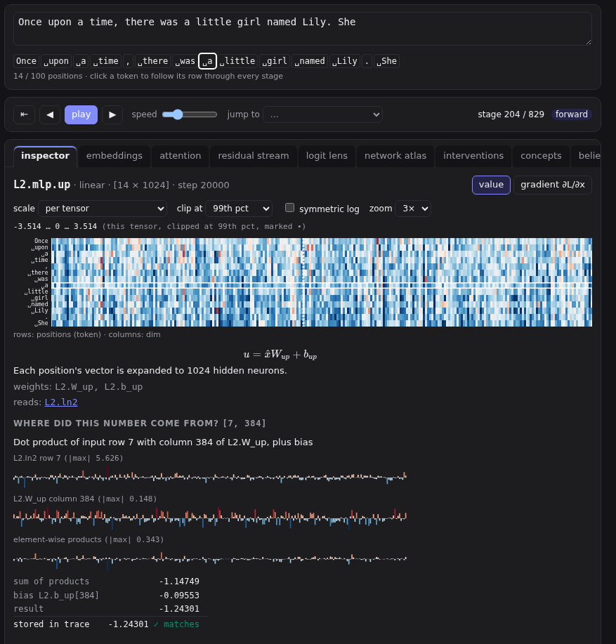
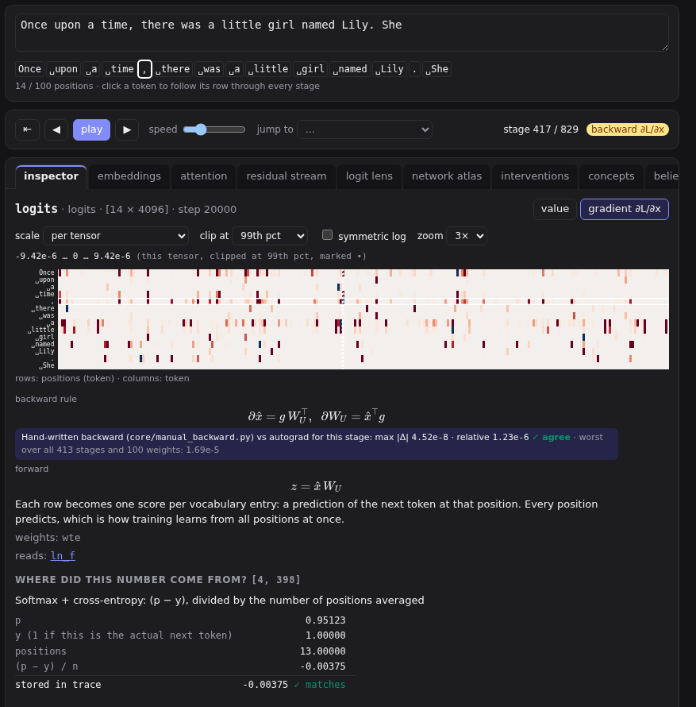

# Inspector

The inspector shows the selected stage's numbers as a heatmap, and explains any one of them.

## Reading the heatmap

- **Rows are positions**, labelled with their token, in every view. Follow one row from stage to stage to follow one token.
- **Columns** are the vector's dimensions. For attention stages they are key positions, and for `logits` and `probs` they are vocabulary entries.
- Above the heatmap: the stage's id, its kind, its shape (positions × columns), and the training step of the weights.
- Below it: the stage's formula, a sentence on what it does, the weights it uses, and the stages it reads (click those to go to them).

Hover a cell for its value. Click it to select that position and dimension, and to see where the number came from.

## Where did this number come from?

Clicking a cell recomputes it from its inputs and shows the working:

- **A matrix multiply** (Q, K, V, the MLP, the output projection, the logits): the input row and the weight column as bar charts, their element-by-element products, the sum, and the bias.
- **Layer norm**: the row's mean and spread, the normalised value, and the learned scale and shift.
- **Softmax**: each score's exponential and their total.
- **An add**: the two numbers added.
- **Attention scores**: the query and key vectors, and their dot product, divided by √d.

The last line compares the recomputed value with the one stored in the trace: **✓ matches**. Nothing on screen is an animation: every number can be checked.

## Gradients

Switch from **value** to **gradient ∂L/∂x**, or step past the loss in the stepper. Each cell is then how much the loss would change if that number were nudged: red means increasing it would increase the loss.

In the gradient view the inspector also shows:

- **the backward rule**: the formula that turns the gradient of a stage's output into the gradients of its inputs. For the logits it is just *p − y*: the predicted probabilities, minus 1 at the correct token.
- **a hand-written check**: the same gradients computed by plain code written for each operation (`core/manual_backward.py`) and compared with PyTorch's automatic differentiation. They should agree to within rounding.
- **where a gradient came from**, when you click a cell: at a residual add the gradient passes straight through *and* also flows back through the sublayer; the inspector shows the parts.

## Scale and display

- **scale**: *per tensor* (the default, best contrast), *per stage type* (the same scale for, say, every layer's MLP output, so layers can be compared), or *global*.
- **clip at**: very large values would wash out everything else, so the scale stops at the 99th percentile by default. Clipped cells are marked •.
- **symmetric log**: compresses large values, useful for the residual stream, which grows with depth.
- **zoom**: cell size, scrolling sideways. The default, 3×, makes rows tall enough to show their tokens; *fit* squeezes the whole tensor into the panel's width, and up to 10× makes single cells easy to hover. On a 4,096-wide tensor (the logits) cells stop widening sooner, at the largest canvas a browser will draw.

The range in use is always printed above the heatmap.

With interventions active, a third button, **change from intervention**, shows how much each value changed from the original run. See [Interventions](09-interventions.md).
