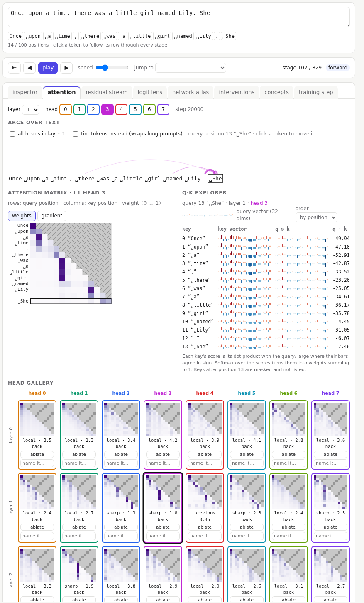
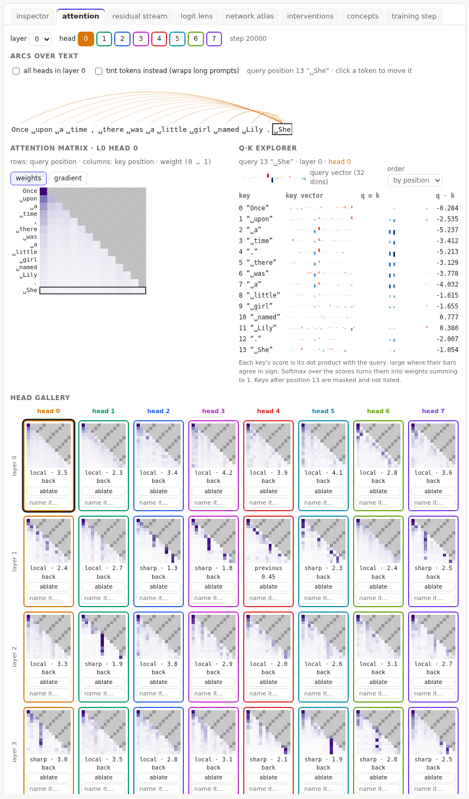

# Attention

Attention is how a position gathers information from earlier ones. Each position makes a **query** (what am I looking for?), a **key** (what do I offer?) and a **value** (what do I pass on?). Its query is compared with every earlier key; the best matches get the most weight, and the output is a weighted average of their values. Each layer does this several times in parallel, with separate **heads**.

The attention tab shows one layer and head at a time. Choose them at the top, or click any attention stage in the pipeline.

## Arcs over the text

The prompt as a row of tokens. The selected position (outlined) draws arcs back to the tokens it attends to: thicker arcs mean more weight. Click a token to move the query.

- **all heads in layer**: every head's arcs at once, in its colour.
- **tint tokens instead**: shades each earlier token by its weight, and wraps long prompts.

## The attention matrix

Every query (row) against every key (column), for this head. Each row sums to 1. The hatched triangle is the **causal mask**: a position can't attend to later ones, because during generation they don't exist yet.

Typical patterns to look for: a bright diagonal (attending to itself), the diagonal just below it (the previous token), or a column that lights up everywhere (a token every position checks). Click a cell to select that query and key.

## The Q·K explorer

Attention as search, made literal. For the selected query, its query vector at the top, then one row per earlier key:

- the key vector,
- the element-by-element products of query and key: large where their bars agree in sign,
- the dot product, and the score after dividing by √d,
- the softmax weight.

Sort **by weight** to see which keys win. Softmax turns a modest lead in score into a large lead in weight.

## The head gallery

Every head's pattern for the current prompt, one row per layer. The badge under each head describes its habit:

- **previous**, **self** or **first** with a number: the head puts that much weight, on average, on the previous position, the position itself, or the first position.
- **sharp · 2.3 back**: most of the weight goes to one key, chosen by content, on average 2.3 positions back.
- **local** or **broad**: weight spread over nearby or many positions.

Badges are measured on the current prompt, so try a few. Give a head a name in the box under it (names are saved in your browser).

**ablate** zeroes that head's output in every view, so you can see what it was doing. Then open the [interventions](09-interventions.md) tab for the effect on the loss and on each prediction. **restore** undoes it.
