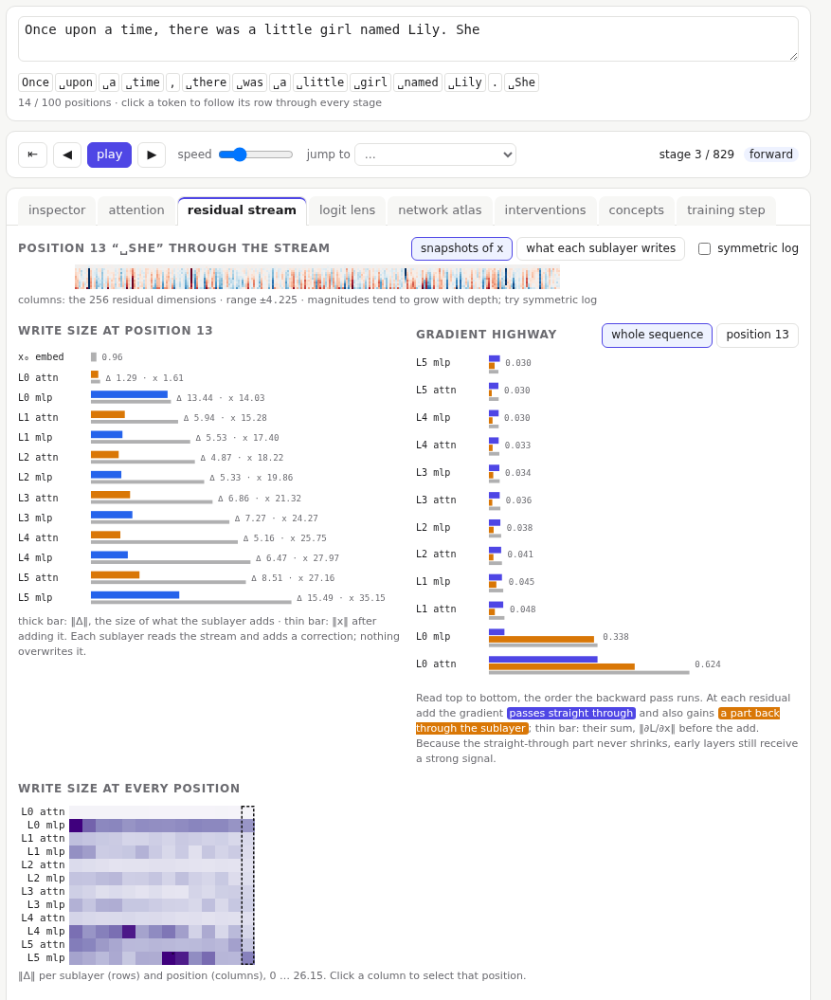
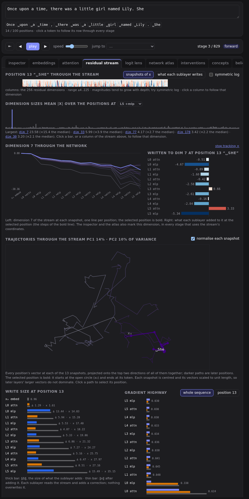
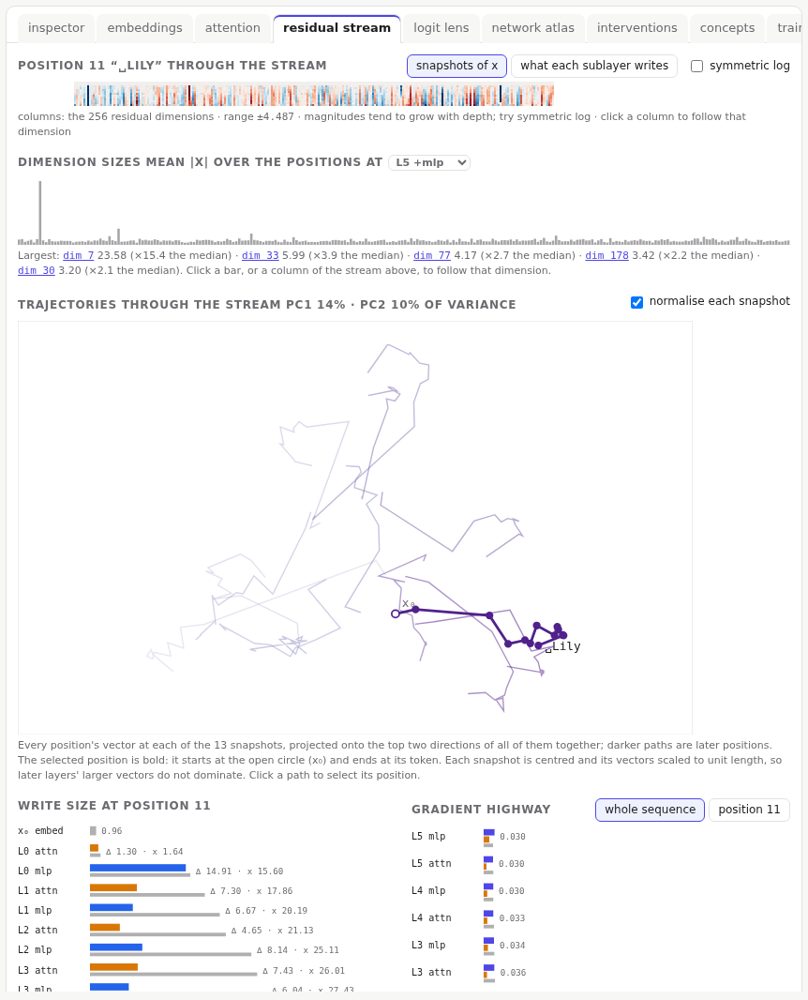
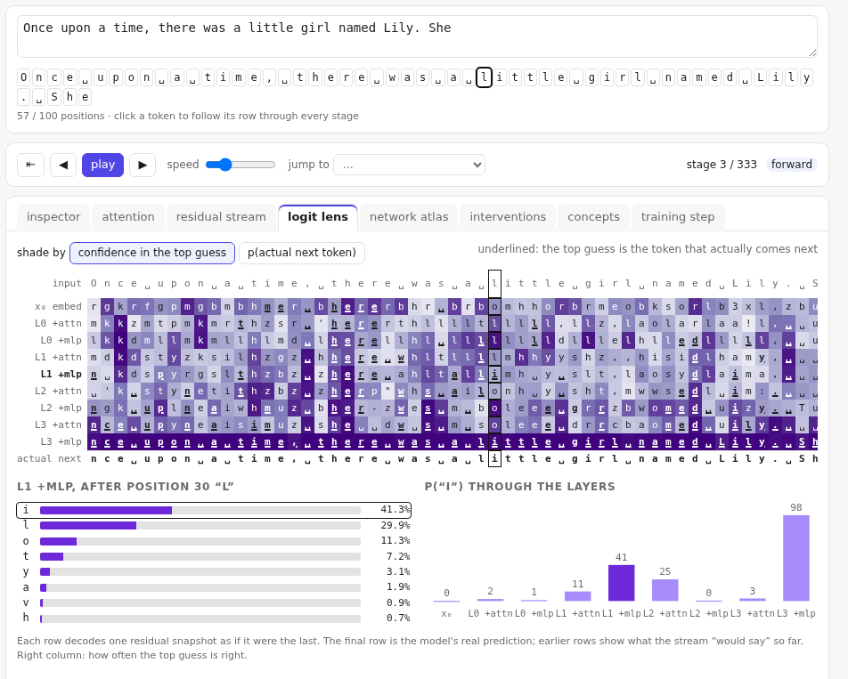

# Residual stream and logit lens

## The residual stream

Each position carries one vector through the whole network: the **residual stream**. The embeddings start it; then every attention and MLP sublayer reads it, computes something, and **adds** its result. Nothing overwrites the stream. It is a shared workspace that every layer writes into.

The residual stream tab follows the selected position (click a token chip to change it):

- **Position through the stream**: one row per snapshot, after the embedding and after each attention and MLP. Switch to **what each sublayer writes** to see the additions instead; those rows add up to the final vector. Magnitudes grow with depth, so **symmetric log** helps. Click a column to [track that dimension](#tracking-a-dimension).
- **Write size**: how big each sublayer's addition is at this position (thick bar), next to the size of the stream after it (thin bar).
- **Write size at every position**: the same for every position at once. Click a column to select that position.

### Tracking a dimension

Most of the stream's 256 dimensions mean little on their own, but a few are far larger than the rest. **Dimension sizes** shows each dimension's average size over the positions, at a snapshot you choose, and lists the largest. This is why the [concept explorer](10-concepts.md) centres vectors before comparing them: otherwise the large dimensions make every vector look alike.

Click a bar, a listed dimension, or a column of the stream to **track** it:

- **Dimension d through the network**: its value at every snapshot, one line per position, the selected position bold.
- **Written to dim d**: what each sublayer added to it at the selected position, the steps of the bold line.
- The [inspector](03-inspector.md) and the [atlas](06-atlas.md) mark the tracked dimension's column in every stage that uses the stream's own coordinates: the embeddings, the snapshots, the layer norms, and the two sublayer outputs. Q, K, V, the heads and the MLP's hidden layer use other coordinates, so they are not marked.

**stop tracking ×** (or the × in the inspector) clears it.

### Trajectories

Every position's vector at each snapshot, projected onto the two main directions of all of them together, and drawn as a path from the embedding (open circle, x₀) to the last layer. Darker paths are later positions; the selected position is bold and labelled with its token. Paths that run together are positions the model is treating alike at that depth; a path that jumps shows a sublayer that changed that position a lot.

**normalise each snapshot** (on by default) centres each snapshot and scales its vectors to unit length. Without it, the later layers' larger vectors dominate the picture. Click a path to select its position.

### The gradient highway

On the way back, the loss's gradient reaches each residual add and splits: one part **passes straight through** to the layer below, and another flows **back through the sublayer**. The chart shows the size of each part, layer by layer, from the output down, for the whole sequence or one position.

Because the straight-through part never shrinks, even the first layers get a strong learning signal. This is why deep networks with residual connections train at all.

## The logit lens

The model makes its prediction from the last snapshot only: the final layer norm, then the unembedding. The logit lens applies the same readout to **every** snapshot, showing what the stream would predict if the network stopped there.

- One row per snapshot, one column per position. Each cell is the top guess for the next token; it is **underlined** when that is the token that actually comes next.
- **shade by** the confidence in the top guess, or by the probability of the actual next token.
- The right column is each row's accuracy over the prompt.
- Click a cell: its top guesses, and a chart of the actual next token's probability through the layers.

Reading down a column shows the guess forming: often wrong in the early rows, then right in the last ones. Some predictions are easy enough to read straight from the embeddings; others only appear in the final layers.

Further reading: the logit lens and the residual-stream view of transformers are in the [bibliography](../bibliography.md#reading-the-residual-stream).
