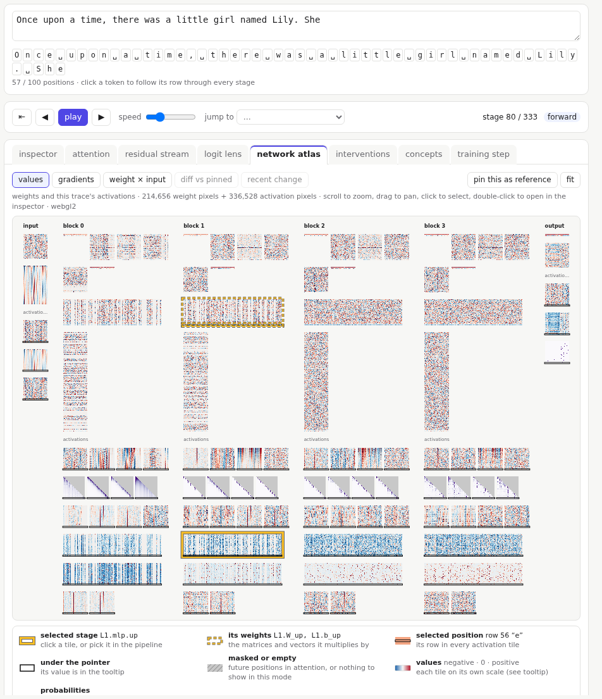

# Network atlas

The atlas is the whole model as one zoomable image: every weight, one pixel per number, with the current prompt's activations under each column. For `bpe-small` that is about 5.8 million weight pixels.

## Layout

- **Columns**, left to right in the order they run: the input (the token and position tables), one column per block, and the output.
- **Weights** at the top of each column: each matrix is a tile, with its bias under it. In a block: layer norm, W_Q, W_K, W_V, W_O, the second layer norm, then the MLP's two matrices.
- **Activations** under each column's weights: one tile per stage, rows as positions.

Where a pixel sits has no meaning of its own: the atlas is a map, to be read alongside the other views.

## Moving around

- **Scroll** to zoom and **drag** to pan. **fit** shows everything.
- Labels appear as you zoom in; zoom further and each cell shows its value.
- **Hover** for the tensor's name, the cell's index and its value.
- **Click** a tile to select its stage: the pipeline map scrolls to it, and every other view follows. **Double-click** opens it in the inspector.
- Clicking an activation cell also selects that position and column, so the [interventions](09-interventions.md#editing-a-value) tab can edit that value, or ablate that neuron if it is in an `mlp.gelu` tile.
- The atlas keeps its zoom and position when you switch tabs and back.

## Marks

The legend under the atlas explains these:

- **Gold outline**: the selected stage's tile. The weights it uses have dashed gold outlines.
- **Thin line across activation tiles**: the selected position's row.
- **Dashed column**: a [tracked residual dimension](05-residual-and-lens.md#tracking-a-dimension), in the embedding tables and in every activation tile that uses the stream's coordinates.
- **Grey hatching**: masked cells, or nothing to show in the current mode.
- **Grey veil over rows**: rows that came from the [KV cache](07-generation.md#kv-cache-mode).

## Modes

- **values**: the weights, and this prompt's activations.
- **gradients**: each weight's gradient (how the loss would change if it changed), and each activation's.
- **weight × input**: for the selected position, what flows through each connection: input value times weight.
- **diff vs pinned**: press **pin this as reference**, then change something (edit the prompt, train, load a checkpoint) to see what changed. Edit one word and only the positions from that word onward change: causality made visible.
- **recent change**: during training, how much each weight moved since the previous snapshot.

## Things worth finding

- **Dead neurons**: columns of the MLP activations that stay white (near zero) for every position.
- **Attention patterns**: the triangles in each head's activation tiles.
- On `bpe-small`: a striped band at the top of the token table. Those are tokens that never appear in the training text. With tied embeddings the output layer pushes all of them the same way, so their rows ended up almost identical (lesson 1 covers this on that model).
