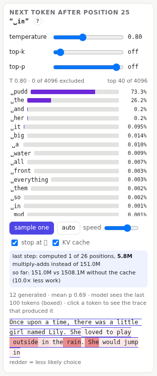
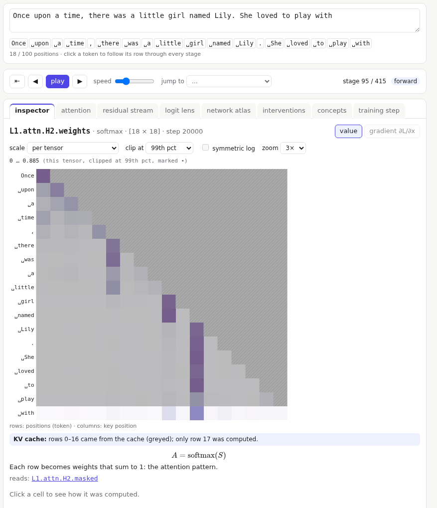

# Generation

The panel at the top right shows what the model predicts next, and generates text one token at a time.

## The next-token distribution

The bars are the probability of each possible next token after the selected position: the last one, unless you clicked a token chip. The token that actually comes next in the prompt is outlined. The panel shows the top 40 of the 4,096.

Three settings reshape the bars live:

- **temperature** divides the scores before they become probabilities. Below 1 the distribution sharpens towards the top choice; at 0 it always picks the top choice (greedy). Above 1 it flattens, giving unlikely tokens a chance.
- **top-k** keeps only the k most likely tokens.
- **top-p** keeps the smallest set of top tokens whose probabilities add up to p.

Excluded tokens are greyed out. The bars show exactly the distribution that gets sampled.

## Generating

- **sample one** draws one token from the bars, appends it to the prompt, and runs the model again.
- **auto** keeps going, at the **speed** you set, until you press **stop**. With **stop at ␄** it also stops at the end of a story.

Generated text appears under the controls, **redder** where the choice was less likely. Hover a token for its probability and rank. **Click** it to load the exact trace that produced it ("time travel"); **back to latest** returns.

The box marks the part of the text the model can still see: its **context window** of 100 positions. When the text grows longer, the window slides and the oldest tokens drop out of the model entirely.

Editing the prompt clears the generated text.

## KV cache mode

Running the whole window again for every new token repeats a lot of work. A position never sees later ones, so appending a token changes nothing at earlier positions. Real models therefore keep each layer's keys and values, the **KV cache**, and compute only the new position.

Tick **KV cache** to work that way. Then:

- every view greys the rows that came from the cache, and the inspector says which row was computed;

  

- the panel counts the work: for example *computed 1 of 69 positions, 236k multiply-adds instead of 15.1M*, and the total saved so far.

The cache stops helping once the text is longer than the window. Then the oldest token drops out and every position shifts by one. The position embeddings are added at the very first layer, so every cached key and value is now wrong, and the model must recompute everything for every new token. The panel reports *cache rebuilt: the window slid*. This is one reason a context window is a hard limit for this kind of model.

Gradients are off while the cache is on.
