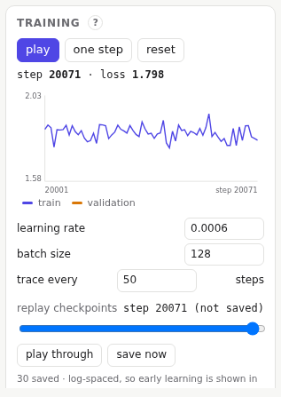
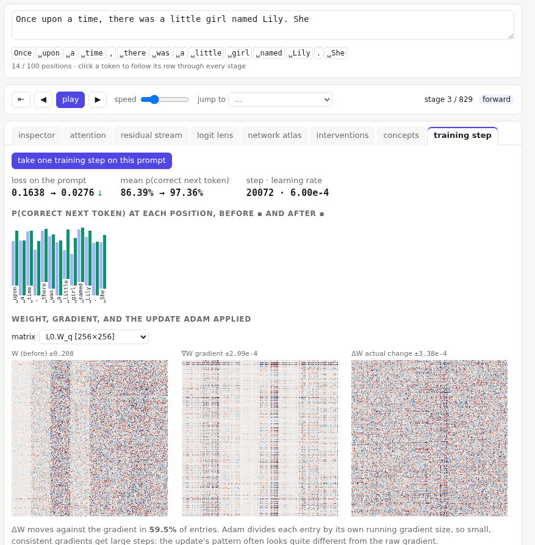

# Training

The app trains the model while you watch. Training runs on the server, between the requests from your views, so every trace always shows one consistent set of weights.

Training is off unless the server is started with **`--train`**:

```sh
uv run python -m core.server --train
```

Without it, the model only runs: the training panel and the training step tab are hidden, and the weights stay exactly as loaded, which suits a class where everyone should see the same model. Lesson 9, which trains, is then disabled in the lessons menu.



## Live training

- **play** and **pause**: train continuously. The loss curve shows each step's training loss (blue) and, from time to time, the loss on held-out text (orange).
- **one step**: a single update.
- **reset**: back to random weights. Training so far is kept only in checkpoints.
- **learning rate**, **batch size**: change them while training runs.
- **trace every**: how often (in steps) the views are refreshed with the new weights.

While it trains, every view updates: watch the attention patterns organise, the predictions improve, and the samples go from noise to stories. A fresh sample appears in the panel every 500 steps.

## Replaying training

Checkpoints are saved at roughly logarithmic intervals (steps 0, 1, 2, 3, 4, 6, 8, 11 … 20,000), so early learning is covered in detail. The **replay** slider jumps to any of them, and **play through** steps through them all. **save now** adds a checkpoint of the current weights.

If the current weights are not saved, the slider says so ("step 20212 (not saved)"), and jumping away saves them first, so no training is ever lost.

## One training step

The **training step** tab takes one update on the prompt itself and shows everything about it.



1. The **loss** on the prompt before and after, and the average probability of the correct next token.
2. **Each position's** probability of the correct next token, before (light) and after (green if it went up, red if down).
3. For any **weight matrix**: the weights before the step, their **gradient**, and the **change** the optimiser actually made.

The gradient and the actual change often look quite different. The optimiser, Adam, divides each entry by its own running gradient size: small but consistent gradients get large steps. The panel gives the share of entries that moved against their gradient.

Take several steps on one prompt and its probabilities climb towards 1. That is the model memorising this prompt, not learning in general, which is why real training uses large, varied batches.

Training steps change the server's weights in memory. Load a checkpoint to go back.
