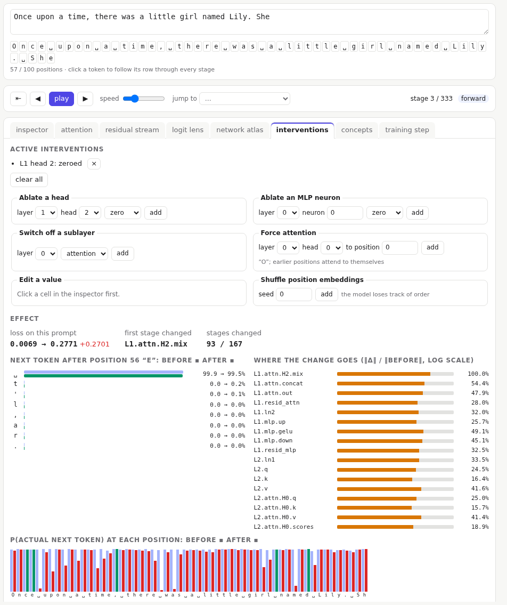

# Interventions

To learn what part of the network does, change it and see what breaks. The interventions tab changes one thing inside the forward pass and compares the result with the original run.

## What you can change

- **Ablate a head**: **zero** its output, or replace it with its **mean** over the prompt's positions (keeping its average contribution but removing what is specific to each position).
- **Ablate an MLP neuron**: zero or mean. Type the layer and neuron, or pick one in the inspector: see [choosing an MLP neuron](#choosing-an-mlp-neuron).
- **Switch off a sublayer**: a block's attention or MLP adds nothing, so the stream passes straight through.
- **Force attention**: a head attends only to one position. Positions before it can't see it, so they attend to themselves.
- **Edit a value**: set any cell selected in the inspector (or the atlas) to a number you choose. What that does depends on the stage: see [editing a value](#editing-a-value).
- **Shuffle position embeddings**: every position is told the wrong position.

Shortcuts: the **ablate** buttons in the [head gallery](04-attention.md#the-head-gallery), and **add as intervention** in the [concept explorer's steering](10-concepts.md#directions-and-steering).

You can combine several. The header shows how many are active; remove them with × or **clear all**.

## Choosing an MLP neuron

1. In the pipeline map, click a block's `mlp.gelu` thumbnail (or use **open it in the inspector** on the tile).
2. In the inspector, click a cell. Its column is the neuron; bright cells are where it fires.
3. Back in the interventions tab, the tile shows **use L1 neuron 37 from the inspector** (with your layer and neuron). Click it to fill in the form, choose zero or mean, and **add**.

Why `mlp.gelu`, and not the other MLP stages:

- A **neuron** is one of the MLP's hidden units. Its output is one column of `mlp.gelu`, and that column, times one row of `W_down`, is everything the neuron adds to the residual stream. Ablating it there removes exactly that neuron's contribution.
- `mlp.up` has the same columns, but **before** the GELU. The neuron passes on GELU(u), not u; replacing u with its mean is not the same as replacing the neuron's output with its mean.
- `mlp.down`, `ln2` and the residual stream are `d_model` wide: each of their columns is a mix of every neuron. Changing one is not ablating a neuron. Use **edit a value** for a single cell there, or **switch off a sublayer** for the whole MLP.
- The GELU is also why neurons mean anything: it acts on each column separately, so its columns are the units the model can switch on and off. Through a matrix multiply alone, any other set of directions would do as well.

Finding a neuron worth ablating: look for a column that is bright at a few positions and pale elsewhere. A column that stays pale for the whole prompt is a neuron that is not firing here, so ablating it changes almost nothing. The concept explorer's [Neurons](10-concepts.md#neurons) panel shows what a neuron responds to across validation text.

Most single neurons change little: the work is spread across many of them, and later layers can partly make up for one that is missing.

## Editing a value

Select a cell, either in the inspector or by clicking an activation tile in the [atlas](06-atlas.md), and the **edit a value** tile names it (for example `L2.resid_mlp[7, 41]`) with its current value. Every stage whose output is positions × columns can be edited, which is all of them except `loss`. The new number replaces the old one on the way through, so every later stage uses it. What that means depends on the stage:

- **The residual stream** (`embed.sum`, `L·.resid_attn`, `L·.resid_mlp`): one dimension of the vector one position carries. Only that position and later ones can change, because attention never looks forward.
- **`embed.tok`, `embed.pos`**: one coordinate of that position's token or position embedding.
- **`L·.mlp.gelu`**: one neuron's output at one position. [Ablating the neuron](#choosing-an-mlp-neuron) does this at every position.
- **`L·.attn.H·.scores`**: how strongly that query is drawn to that key. A cell above the diagonal (a later key) has no effect: the next stage masks it to −∞ anyway.
- **`L·.attn.H·.masked`**: this one breaks the causal mask. Set a cell above the diagonal from −∞ to a number (try 5) and that position attends to a later token: information flows backwards, and that query position changes even though the token it now sees comes later.
- **`L·.attn.H·.weights`**: an attention weight directly. Nothing renormalises it, so the row no longer sums to 1. **Force attention** is the tidy version.
- **`L·.ln1`, `L·.ln2`, `ln_f`**: after the normalisation, so the new value is not rescaled.
- **`logits`**: one token's score at one position. The probabilities and the loss follow.
- **`probs`**: only shown, never used: the loss is computed from the logits. An edit here changes the next-token bars and nothing else, not even the loss. It is a good way to see the difference between what is displayed and what is computed.

The edit stays active, like any intervention, until you remove it. It applies to activations only: weights can't be edited.

## Reading the effect

Every view then shows the changed model. The interventions tab compares it with the original:

- **loss on this prompt**, before and after, and the **first stage changed**: where the effect enters.
- **biggest change, at one position**: the prediction the intervention changed most, with that position's change in loss and the probability of the actual next token before and after. The loss on the prompt averages over every position, so an intervention that matters a lot in a few places can look small there; click the change to select that position.
- **Next token**: the distribution before and after, for the selected position.
- **Where the change goes**: every changed stage in the order they run, with how much it changed relative to its size. Click one to open it in the inspector, which then shows the **change from intervention**.
- **p(actual next token) at each position**, before and after: where the change matters for the predictions.

The pipeline map outlines changed stages in orange.

Two experiments that show **causality**:

- **Edit a value** at position 30 and watch the logits: only positions from 30 onward change, because no position can see a later one.
- **Shuffle the position embeddings**: the predictions fall apart, because the model has lost track of order.

Interventions apply only to the traces you look at. Training never sees them.

Further reading: causal tracing, activation patching and self-repair are in the [bibliography](../bibliography.md#interventions-and-activation-patching).
