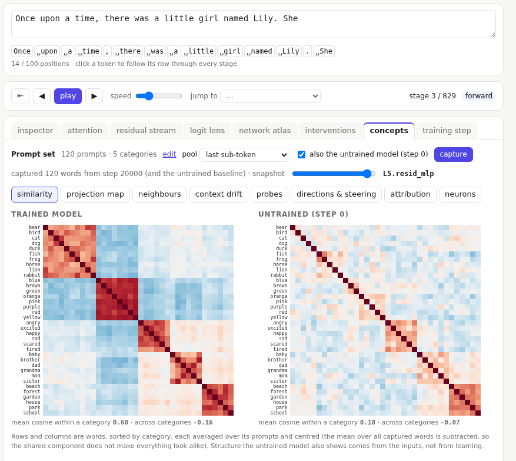
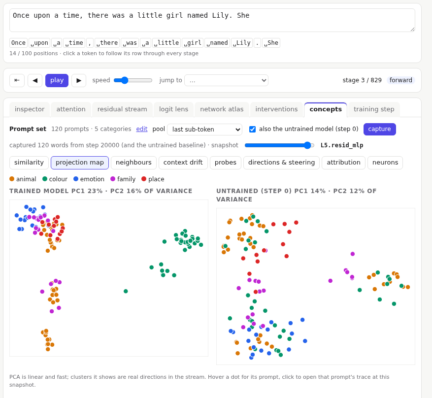
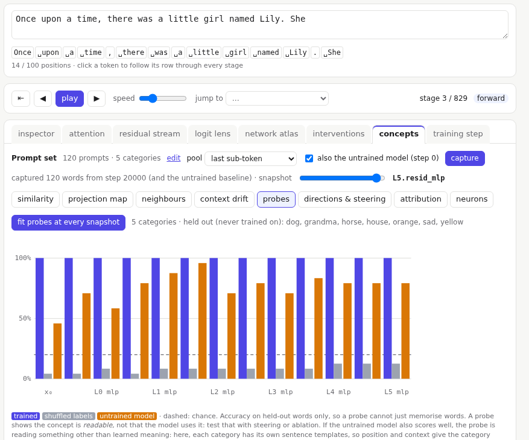
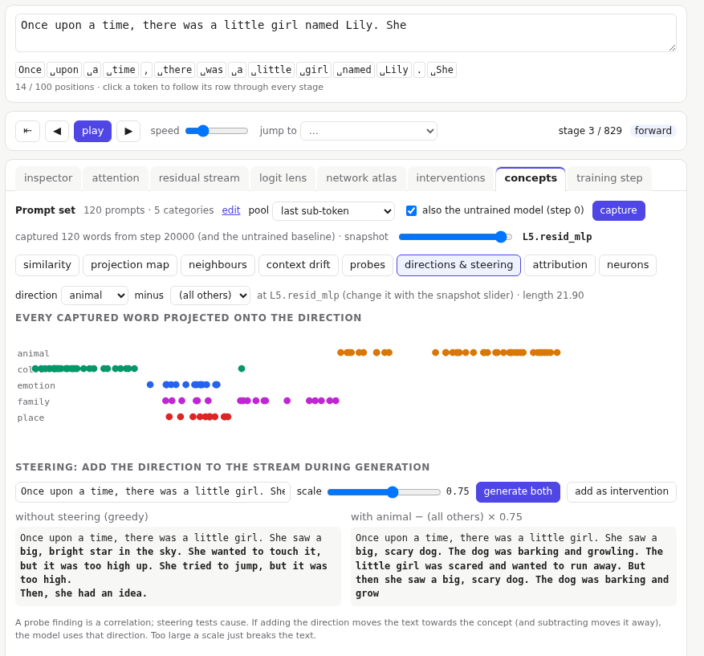
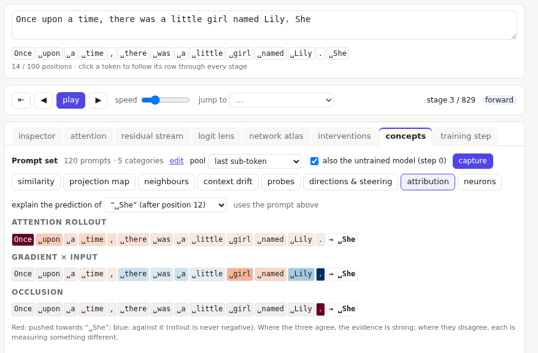

# Concept explorer

The concept explorer asks how the model represents words. Does it treat *dog* and *cat* as alike? At which layer does "animal" become readable? Is there a direction for it, and does pushing along it change what the model writes?

The model's 4,096-token vocabulary makes most words a single token, so each word has one vector per layer to compare. A rare word split into several tokens is read at its last piece, or averaged with **mean of sub-tokens**.

## Capture

The **prompt set** defines categories of words and sentence templates:

```text
@animal: dog cat bird fish rabbit
@colour: red blue green yellow
Lily saw a {animal} in the garden.
She had a {colour} ball.
```

Each template is filled with every word of its category, so this set gives 5 + 4 = 9 prompts. The word filled in is the **target**. Press **edit** to change the set; see [Prompt sets](../instructors/prompt-sets.md) for writing good ones.

**capture** runs every prompt through the model. For each target word it records the residual-stream vector at every snapshot: after the embedding, then after each attention and each MLP. That is 13 snapshots on `bpe-small`. If a word is split into several tokens, **pool** takes the last one or their average.

Keep **also the untrained model** ticked. It captures the same prompts with the random weights from before training, so you can tell what was learned from what simply comes from the inputs.

Capture uses the weights loaded at that moment. Capture again after training or loading a checkpoint.

The **snapshot** slider picks the layer you are looking at, from `embed.sum` to the last `resid_mlp`.

## Similarity



How alike every pair of words is, as cosine similarity: 1 means the same direction. Words are sorted by category, so a category the model has learned shows as a bright block. Under each matrix: the average similarity within categories and across them.

Before comparing, the vectors are **centred**: the average of all captured vectors is subtracted. Raw residual vectors share a large common part that makes everything look alike.

## Projection map



Every captured occurrence as a dot, placed by the two directions along which the vectors vary most (principal component analysis), coloured by category. Clusters mean the categories are separated in the stream. Hover a dot for its prompt; click it to open that prompt's trace in the inspector.

## Neighbours

For one word: its nearest neighbours in the **token embedding table** (before any context), and among the captured words at the chosen snapshot (in context).

## Context drift

For a word that appears in several prompts: how similar its vectors are across those prompts, at every snapshot. At the embeddings every occurrence is the same token, so similarity starts high; how far it falls shows how much the layers mix context into the word.

## Probes



**fit probes** trains a simple classifier at each snapshot to tell the categories apart. It is tested only on words it never saw in training (listed above the chart), so it cannot simply memorise words. Three bars per snapshot:

- **trained** model,
- **shuffled labels**: the same probe with categories assigned at random, which should do no better than chance (the dashed line),
- **untrained** model.

A probe shows that a concept is **readable** from the vectors, not that the model **uses** it. If the untrained model also scores well, the probe is picking up something else. Often that is the sentence template, if each category has its own templates.

## Directions and steering



Pick a category (and what to subtract: all the others, or one other category). The **direction** is the difference between the two groups' average vectors at the chosen snapshot. The strip shows every captured word projected onto it.

Steering tests whether the model uses that direction. **generate both** continues your prompt twice, without and with the direction added to the stream at that snapshot, at the **scale** you set. If the steered text moves towards the concept (and away from it at negative scales), the direction matters to the model. Too large a scale just breaks the text into repetition.

**add as intervention** applies the steering to every view, as an [intervention](09-interventions.md).

## Attribution



Which tokens of the main prompt drove a prediction? Pick a prediction to explain; three methods colour each earlier token, red for pushing towards the prediction and blue against:

- **attention rollout**: how much attention, compounded through the layers, flows from each token.
- **gradient × input**: a first-order estimate of each token's effect on the prediction.
- **occlusion**: the actual drop in the prediction's log probability when the token's embedding is removed.

Where the three agree, the evidence is strong. Where they disagree, each is measuring something different.

## Neurons

Pick an MLP neuron (or use the one selected in the inspector) and **find what it responds to**: its strongest activations over validation text, with the token where it fires in bold. Many neurons respond to several unrelated things.
