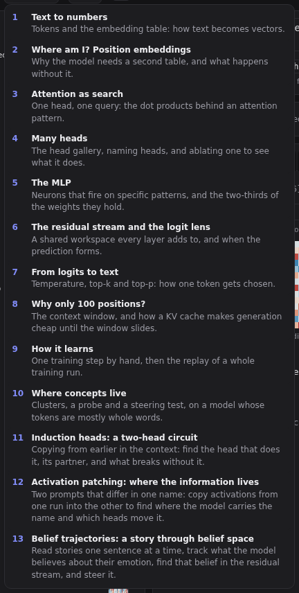
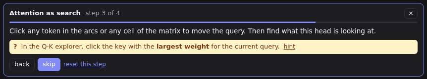

# Lessons

Lessons are guided tours of the app. Each step sets up the views (a prompt, a tab, a stage, a head) and explains what to look at. Some steps ask you to find something.

Open **lessons** in the header and pick one. A lesson that can't run on this server is greyed out, with what to start the server with: a different `--config`, or `--train` for the lesson that trains the model.

- **next** and **back** move between steps; **reset this step** sets the views up again if you have wandered off.
- A **?** question checks what you click and turns into a **✓** with an explanation when you find it. **hint** helps; **skip** moves on without answering.
- Close a lesson with ×. Everything it changed stays as it was, so you can keep exploring from there.

## The lessons

| # | Lesson | What it shows |
| --- | --- | --- |
| 1 | Text to numbers | Tokens, the embedding table, and tokens the model never saw |
| 2 | Where am I? Position embeddings | Why order needs its own table, and what happens without it |
| 3 | Attention as search | One head, one query: the dot products behind an attention pattern |
| 4 | Many heads | The head gallery, naming heads, and ablating one |
| 5 | The MLP | Neurons that fire on specific patterns |
| 6 | The residual stream and the logit lens | A shared workspace, and when the prediction forms |
| 7 | From logits to text | Temperature, top-k and top-p |
| 8 | Why only 100 positions? | The context window, and the KV cache |
| 9 | How it learns | The loss, gradients, one training step, and replaying a whole run (needs `--train`) |
| 10 | Where concepts live | Clusters, a probe and a steering test |
| 11 | Induction heads | A head that copies from earlier in the context, its previous-token partner, and ablating it |
| 12 | Activation patching | Two prompts that differ in one name: where the information sits, and which heads move it |
| 13 | Belief trajectories | A story's emotional belief, sentence by sentence: read it, find it in the stream, steer it, and see what moves with it |
| 14 | Fine-tuning with LoRA | Train a low-rank adapter on dragon stories, see where it plugs in, and how far it tilts the model |
| 15 | Teaching a refusal: preference tuning with DPO | A preference-tuned adapter that declines unsafe-play requests: scored pairs, held-out requests, and the refusal direction (needs the shipped `refusal` adapter) |

Lesson 9 trains the model, so it needs a server started with `--train`; the others work on any server. Lesson 14 trains only an adapter, which leaves the model's weights alone, so it needs no `--train`. Lesson 15 needs the `refusal` adapter that ships with the model (see [Fine-tuning](14-fine-tuning.md)).

Model-dependent answers, such as "click the sharpest head", are worked out from the live model, so lessons work at any training checkpoint, even partway through training.
