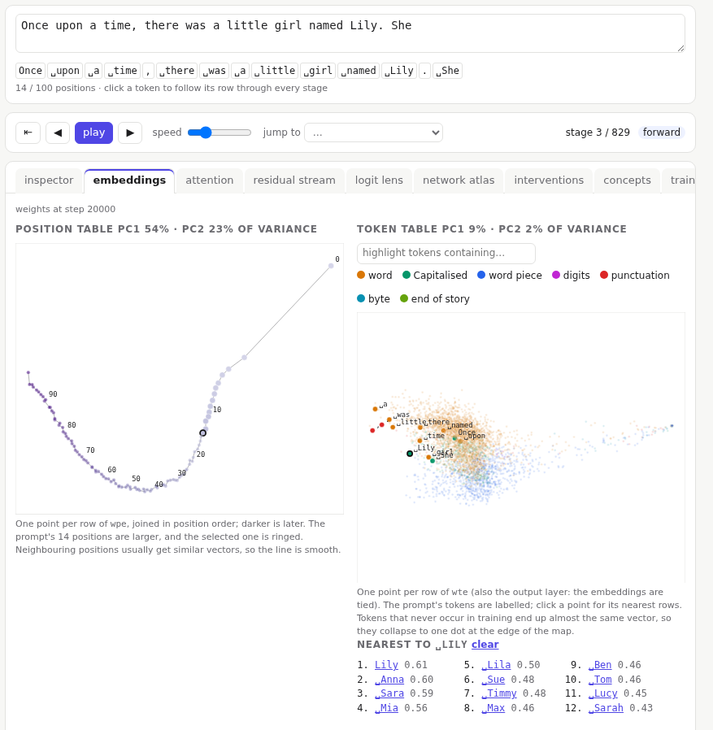

# Embeddings

The model starts from two learned tables: the **token table** `wte`, one 256-number row per vocabulary entry, and the **position table** `wpe`, one row per position. Every token's journey begins with one row of each, added together. The **embeddings** tab draws both tables as maps.

Each map projects the table's rows onto its two main directions (principal components), so points that sit close together are rows the model treats as alike. The header says how much of the table's variation the two axes capture: a map is a flat shadow of a 256-dimensional cloud, and the rest of the variation is not shown. Both axes use the same scale, so shapes are not stretched.

## Position table

One point per position, joined in order and darker for later positions. The prompt's positions are larger, and the selected position is ringed; click one of the prompt's positions to select it.

The line is usually smooth: neighbouring positions get similar vectors. That lets attention tell "just before" from "long ago" with a single dot product. The first few positions often stand apart from the rest, because the start of a text behaves differently from its middle.

## Token table

One point per vocabulary entry, coloured by what the token looks like: a word with its leading space (`␣dog`), a capitalised word, a word piece without a space, digits, punctuation, a raw byte, or the end-of-story marker.

- The prompt's tokens are labelled.
- Type in the box to highlight every token containing some text.
- Click a point to list the 12 rows closest to it (by cosine similarity, in all 256 dimensions, not just the two drawn). Names tend to sit near names, and words used in similar ways near each other.

One dot at the edge of the map is many tokens stacked on one spot: the tokens that never occur in the training text. Because the embeddings are tied, `wte` is also the output layer, and every training step pushes all of those rows the same way, so they ended up almost identical. Lesson 1 shows the same thing in the [network atlas](06-atlas.md) as a band of stripes.

## While training

The token map takes about a second to compute, so it is not redrawn on every training step. While training runs, the maps keep the weights they were drawn from and say so; **refresh the maps** redraws them.
