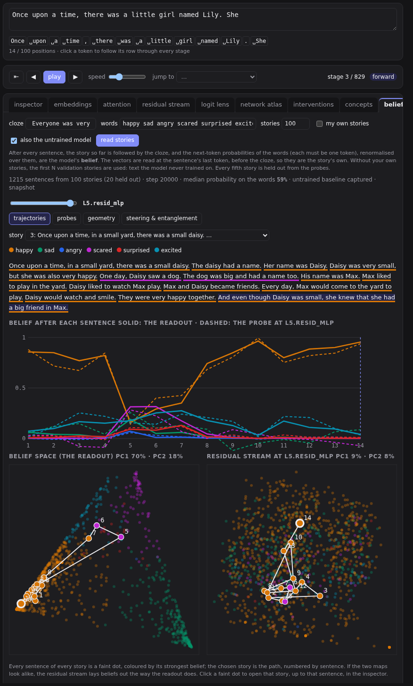
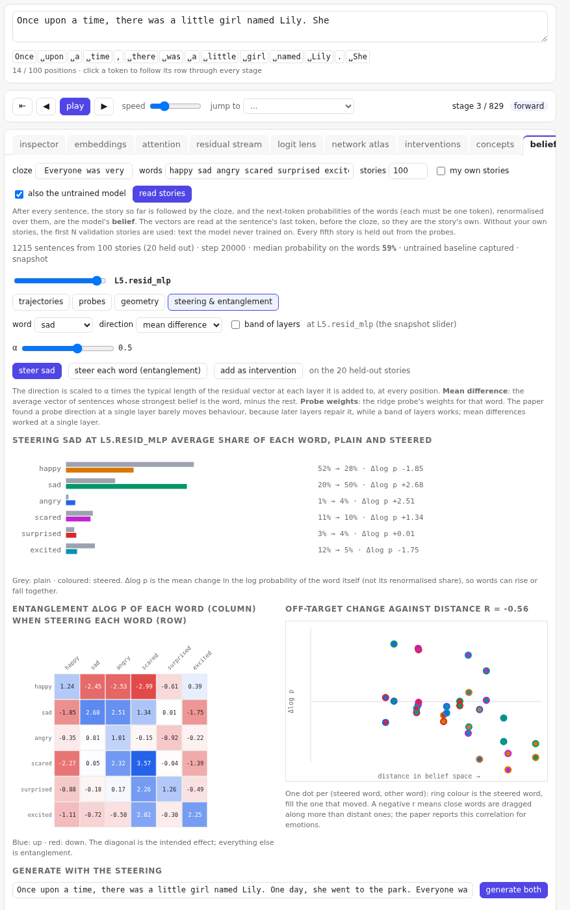

# Belief trajectories

What does the model believe about a story's mood as it reads, and where in the network does that belief live? The **beliefs** tab, after **concepts** in the tab bar, reads whole stories one sentence at a time and measures the model's belief after each sentence. It then studies that belief with the same kinds of tools the [concept explorer](10-concepts.md) uses on single words: probes, geometry and steering.

The paper [Stories in Space](https://arxiv.org/abs/2605.12412) (Bigelow et al., 2026) reports four things about how a language model reads a story:

- As the model reads, its **belief** about the story (how happy, sad or scared it is) moves along a path through a low-dimensional space.
- A linear probe can read that belief from the activations.
- Concepts sit at similar distances from each other in both spaces.
- Steering along a concept's direction moves the belief, and it drags nearby concepts along with it.

The **beliefs** tab repeats those experiments on this model.

The paper asks an 8-billion-parameter chat model to rate each emotion from 0 to 10. A small story model can't answer questions, so the tab asks with a **cloze** instead. After each sentence, the story so far is followed by **Everyone was very**. The next-token probabilities of `happy sad angry scared surprised excited`, rescaled to sum to 1, are the belief. You can edit both the cloze and the words. Each word must be a single token.

**read stories** runs the first N stories of the validation set (text the model never trained on), or stories of your own, one per paragraph. Every sentence gets one forward pass. The residual vector is read at the sentence's last token. That is before the cloze, and because the model is causal it is the same as the bare story's vector: the probes never see the question. A prefix longer than the window keeps its last tokens, so it fits together with the cloze. The tab shows the median probability the model puts on the six words. If that number is small, the cloze is not working.

Every fifth story is held out. Probes never train on it, and steering is measured on it.

## The four sections

- **trajectories**: one story with its sentences clickable, and its belief after each one. The readout is solid; once probes are fitted, the probe's prediction at the snapshot is dashed. Below are two PCA maps of every sentence of every story, coloured by the strongest word. The left map is belief space, a simplex whose corners mean "only this word". The right map is the residual stream at the snapshot. The chosen story is drawn as a numbered path. Click a faint dot to open that story, up to that sentence, in the inspector.
- **probes**: ridge regression from the vectors to the six numbers at every snapshot, with error on held-out stories. There are two baselines. One always guesses the training average (dashed). The other uses the untrained model's vectors to predict the *trained* model's belief, which shows how much can be read from the words alone. Below that is the correlation for each word at the snapshot.
- **geometry**: each word's centroid is the mean over the sentences with the highest share of it, at most 3 from any one story. There are two distance matrices: one for belief space and one for the residual stream at the snapshot. A chart shows the correlation between them at every snapshot. With six words there are only 15 pairs, so treat r as a rough guide.
- **steering & entanglement**: adds a word's direction to the stream at every position while the held-out stories are read again.
  - **Mean difference** is the average vector of sentences whose strongest belief is that word, minus the rest.
  - **Probe weights** are the probe's weights for the word.
  - **α** is the strength, in units of the typical residual length at each layer it is added to.
  - **band of layers** adds a direction after every MLP from one layer to another. Each layer gets its own direction.

  The paper found a probe direction at one layer is often repaired by the layers after it, while a band works. **steer each word** fills the entanglement matrix: the change in each word's log probability (columns) when each word is steered (rows). It also draws a scatter of the off-target changes against distance in belief space. A negative r means nearby words move together.

On `bpe-small`, with 100 stories:

- **Probes:** test error falls from about 0.24 at x₀ to about 0.13 by L3, against 0.23 for always guessing the average. The untrained model's vectors stay near that baseline.
- **Steering:** steering **sad** with probe weights over L1 to L3 at α 0.5 raises its share on held-out stories from 20% to over 90%.
- **Entanglement:** the negative feelings rise together.

Change is measured in log probability, not share. Shares always sum to 1, so if one rises the others must fall; log probabilities can all rise together. Lesson 13 walks through the tab. The [bibliography](../bibliography.md#belief-trajectories) lists the paper and the work it builds on.
